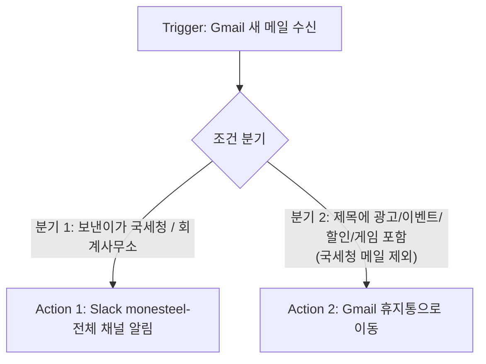

# [프로젝트 1] 자동화 도구 비교 구현 — Zapier vs Make

## 1. 프로젝트 개요

동일한 자동화 워크플로우를 **서로 다른 두 도구(Zapier, Make)** 로 구현하고, 구성 화면과 실행 결과를 캡처한 뒤 비교 분석한다.

### 자동화 업무: Gmail 수신 메일 자동 분류 및 알림

Monesteel 비즈니스 Gmail 계정으로 국세청, 회계사무소, 광고 메일이 섞여 수신되어 중요 메일을 놓치고 메일함이 혼잡해지는 문제를 해결한다.

- 국세청(@nts.go.kr), 회계사무소 박정아 대리(jung***@nate.com)의 메일 → **Slack 알림**
- 제목에 광고성 키워드가 있는 메일 → **Gmail 휴지통으로 이동**

### 과제 요건 충족 현황

| 요건 | 구성 |
|------|------|
| 서로 다른 2개 이상의 도구 | Zapier, Make |
| 동일한 워크플로우 구조 | 두 도구 모두 `Trigger → 조건 분기 → Action` 구조 (3장 참고) |
| Trigger 1개 이상 | Gmail 새 메일 수신 |
| Action 2개 이상 | ① Slack 메시지 전송 ② Gmail 메일 휴지통 이동 |
| 조건 분기 1개 이상 | 발신자 조건(중요 메일) / 제목 조건(광고 메일) |
| 분기 경로별 1회 이상 실행 확인 | 7장에서 두 도구 모두 각 경로의 실행 결과 확인 |

---

## 2. 사용한 도구

| 구분 | 도구 1 | 도구 2 |
|------|--------|--------|
| 도구 이름 | **Zapier** | **Make** (구 Integromat) |
| 유형 | 노코드 자동화, 선형 단계형(Zap) | 노코드 자동화, 캔버스 모듈 연결형(Scenario) |
| 분기 방식 | Zap별 **Filter by Zapier** | 하나의 시나리오 안의 **Router + 경로별 Filter** |

---

## 3. 공통 워크플로우 설계

### 3-1. 논리 구조 (두 도구 공통)



```
[Trigger] Gmail 새 메일
      │
  [조건 분기]
      ├─ 분기 1: 보낸이 = 국세청 / 회계사무소 ──▶ [Action 1] Slack 알림
      └─ 분기 2: 제목에 광고성 키워드 ──────────▶ [Action 2] Gmail 휴지통 이동
```

### 3-2. 분기 조건 (두 도구 동일)

| 분기 | 조건 | Action |
|------|------|--------|
| 분기 1 | 보낸이 주소에 `nts.go.kr` 또는 `jung***@nate.com` 포함 | Slack 채널(monesteel-전체)에 제목·보낸이 알림 |
| 분기 2 | 제목에 `광고` / `이벤트` / `할인` / `게임` 중 하나 포함 **그리고** 보낸이에 `nts.go.kr` 미포함 | Gmail 휴지통 이동 (영구 삭제 아님, 30일 내 복구 가능) |

### 3-3. 도구별 구현 방식 차이

| 항목 | Zapier | Make |
|------|--------|------|
| 분기 구현 | 분기별로 Zap을 하나씩 만들고 각 Zap에 Filter 설정 (Zap 2개) | 시나리오 1개에 Router로 두 경로를 만들고 경로별 Filter 설정 |
| Trigger | Gmail - New Email | Gmail - Watch emails |
| Action 1 | Slack - Send Channel Message | Slack - Send a Message |
| Action 2 | Gmail - Delete Email (Message ID 연결, 휴지통으로 이동) | Gmail - Move an email (New folder: Trash) |

> Zapier의 Paths(한 Zap 안의 분기 기능)는 요금제 제한이 있을 수 있어, 무료 플랜 기준으로 **Zap별 Filter** 방식으로 동일한 논리 구조를 구현했다. (요금제는 공식 사이트에서 확인)

---

## 4. 구현 과정 요약

### 4-1. Zapier

| Zap | 단계 | 설정 내용 |
|-----|------|-----------|
| Zap A. 중요 메일 알림 | Trigger | Gmail - New Email |
| | Filter | From Email Contains `nts.go.kr` OR `jung***@nate.com` |
| | Action | Slack - Send Channel Message (monesteel-전체) |
| Zap B. 광고 메일 휴지통 이동 | Trigger | Gmail - New Email |
| | Filter | Subject Contains 광고 OR 이벤트 OR 할인 OR 게임 |
| | Action | Gmail - Delete Email (Message ID 동적 연결) |

**요약**: 각 Zap이 Trigger → Filter → Action의 직선 구조라 설정이 단순하다. 필드를 채우고 Test를 누르면 단계별 결과를 바로 확인할 수 있었고, 광고 메일은 도착 직후 휴지통으로 이동했다. 처음에는 국세청, 회계사무소, 광고를 Zap 3개로 나누어 만들었다.

### 4-2. Make

| 순서 | 모듈 | 설정 내용 |
|------|------|-----------|
| 1 | Gmail - Watch emails (Trigger) | Filter type: Gmail filter / Query: `in:inbox -from:me (from:{nts.go.kr jung***@nate.com} OR subject:(광고 OR 이벤트 OR 할인 OR 게임 OR "(AD)" OR "[AD]"))` / Limit 10 / 시작 지점 From now on |
| 2 | Router | 경로 2개 |
| 3-1 | 경로 1 Filter | `{{1.from.address}}` Contains `nts.go.kr` OR `jung***@nate.com` |
| 4-1 | Slack - Send a Message (Action 1) | 채널 monesteel-전체, 제목 `{{1.subject}}`, 보낸이 `{{1.from.address}}` |
| 3-2 | 경로 2 Filter | `{{1.subject}}` Contains 광고/이벤트/할인/게임 AND `{{1.from.address}}` Does not contain `nts.go.kr` |
| 4-2 | Gmail - Move an email (Action 2) | Source: Inbox / Message ID: `1. Message ID` / New folder: Trash |

**구현 중 겪은 문제와 해결**

| 문제 | 원인 | 해결 |
|------|------|------|
| Slack에 "Create a Message"가 없음 | 모듈 이름 변경 | Send a Message 사용 |
| "didn't return any new data" | 시작 지점이 From now on이라 새 메일 없음 | Choose where to start로 과거 메일 선택 후 테스트 |
| 메일 1건 테스트인데 Slack에 10건 전송 | 시작 지점은 "그 메일 이후 전체", Limit 10 | 테스트 시 Limit 1, 테스트 후 From now on과 10으로 복구 |
| 시나리오 3개째 활성화 불가 | 무료 플랜 활성 시나리오 2개 제한 | 하나의 시나리오로 통합(Router 구조) |
| `[400] Invalid label: TRASH` 오류 | Update email labels는 휴지통을 라벨로 처리 못 함 | Move an email 모듈(New folder: Trash)로 교체 |
| Labels to add에 Select All 체크됨 | 선택 실수 | 전체 해제 후 필요한 항목만 선택 |

**요약**: 캔버스에서 모듈을 연결하는 방식이라 분기 구조가 한눈에 보이고 Gmail 검색 문법(Query)을 그대로 쓸 수 있다. 반면 시작 지점, 폴더, 라벨, 매핑 등 설정 항목이 많아 시행착오가 있었다. 무료 플랜 실행 주기는 15분이다.

---

## 5. 구성 화면 캡처 (도구별 워크플로우)

> 📸 **캡처 위치 안내**
> - **Zapier**: 대시보드 → Zaps → 각 Zap 편집 화면 (Trigger/Filter/Action 3단계 전체), Filter 설정, Slack 메시지 설정, Delete Email 설정
> - **Make**: Scenarios → 시나리오 편집 화면 (Router로 갈라지는 전체 워크플로우), Watch emails 설정, 경로 1·2 Filter 설정, Slack 설정, Move an email 설정
>
> ⚠️ 캡처 전 **8장 보안 체크리스트**로 민감정보를 가린다.

### 5-1. Zapier 구성 화면


### 5-2. Make 구성 화면


---

## 6. 비교 분석 보고서

### 6-1. 비교 항목표

| 비교 항목 | Zapier | Make |
|-----------|--------|------|
| ① UI/UX | 단계형 목록(Trigger→Filter→Action). 단순하고 직관적 | 원형 모듈을 잇는 캔버스. 분기 구조가 한눈에 보이나 처음엔 낯섦 |
| ② 설정 난이도 | 낮음. 필드를 채우면 바로 동작 | 중간. 시작 지점, 폴더, 매핑 등 신경 쓸 항목이 많음 |
| ③ 조건 분기 방식 | Filter 단계(분기별로 Zap을 분리). Paths는 요금제 확인 필요 | 한 시나리오 안에서 Router와 경로별 Filter로 분기 |
| ④ 조건 설정 유연성 | Filter 필드와 연산자 선택 방식 | Gmail Query(검색 문법)와 Filter를 함께 사용해 세밀한 조건 가능 |
| ⑤ 연동 서비스 범위 | 공식 연동 앱이 매우 많음 | 연동 앱이 많고 모듈이 앱 기능별로 세분화됨 |
| ⑥ 무료 플랜 범위 | 월 task 수가 적어 광고 메일이 많으면 빨리 소진 | 월 operations가 비교적 넉넉하나 활성 시나리오 2개 제한 |
| ⑦ 실행 속도 | 새 메일을 거의 즉시 처리 | 무료 플랜은 15분 간격 |
| ⑧ 실행 로그 확인 | Zap History에서 단계별 성공/실패 확인 | History와 모듈 말풍선, Operation별 입출력 데이터 확인. 실행된 경로 파악이 쉬움 |
| ⑨ 오류 대응 | 오류 메시지가 간단 | 오류 코드와 입력 Bundle까지 표시되어 원인 추적이 쉬움 |
| ⑩ 테스트 방식 | Test 탭에서 샘플 메일로 단계별 테스트 | Run once와 Choose where to start로 메일을 골라 테스트, Limit 조절 필요 |

(무료 플랜의 한도와 주기는 개편될 수 있으므로 최신 정책은 공식 사이트에서 확인한다.)

### 6-2. 도구별 장단점

**Zapier**

| 장점 | 단점 |
|------|------|
| 설정이 쉽고 빨라 입문자에게 적합 | 무료 플랜 task 한도가 작음 |
| 새 메일을 즉시 처리 | 분기마다 Zap을 나눠야 하거나 분기 기능이 요금제에 묶일 수 있음 |
| 공식 연동이 풍부하고 안정적 | 세밀한 Gmail 검색 조건 활용에 제약 |

**Make**

| 장점 | 단점 |
|------|------|
| Router로 한 시나리오에서 분기 구조를 구성, 흐름이 시각적 | 처음 배우는 데 시간이 더 걸림 |
| Gmail 검색 문법 등 세밀한 조건 설정 가능 | 무료 플랜은 활성 시나리오 2개, 15분 주기 |
| 실행 로그가 상세해 디버깅이 용이 | 시작 지점·Limit을 잘못 두면 의도치 않은 대량 실행 발생 |
| operations 한도가 비교적 넉넉 | 모듈별 기능이 달라 적합한 모듈을 찾아야 함 (예: 휴지통 이동은 Move an email) |

### 6-3. 어떤 상황에 적합한가 (의견)

- **Zapier**: 빠르게 만들어 바로 써야 하는 단순 자동화, 즉시성이 중요한 알림, 자동화 경험이 적은 사용자에게 적합하다. 이번 업무에서는 중요 메일 알림에 잘 맞는다.
- **Make**: 분기가 있거나 조건이 복잡한 자동화, 로그를 세밀히 보며 개선해야 하는 경우, 작업량 한도가 넉넉해야 하는 경우에 적합하다. 이번 업무에서는 건수가 많고 조건을 정교하게 줘야 하는 광고 메일 정리에 유리하다.
- **종합 의견**: Zapier는 "쉽고 빠름", Make는 "분기와 로그가 명확함"이 특징이다. 같은 메일을 두 도구가 동시에 처리하면 충돌하거나 어느 쪽이 처리했는지 구분되지 않으므로, **운영 시에는 한 업무당 한 도구만 켜 두는 것**이 안전하다.

---

## 7. 실행 결과 화면 캡처 (분기 경로별 실행 확인)

각 분기 경로가 실제로 1회 이상 실행되었음을 도구별로 확인한다.

### 7-1. 테스트 방법

| 도구 | 분기 1 (중요 메일 → Slack) | 분기 2 (광고 메일 → 휴지통) |
|------|----------------------------|------------------------------|
| Zapier | Zap A 편집 화면 → Test 실행(국세청/회계사무소 메일 샘플) → Slack 수신 확인, Zap History 캡처 | Zap B Test 실행(광고 메일 샘플) → Gmail 휴지통 확인, Zap History 캡처 |
| Make | Choose where to start에서 국세청/회계사무소 메일 1건 선택, **Limit 1**, Run once → **Slack 모듈에만 말풍선 숫자** 확인 | 광고성 제목 메일 1건 선택, **Limit 1**, Run once → **Move an email 모듈에만 말풍선 숫자** 확인 |

Make 테스트 후에는 시작 지점을 **From now on**, Limit을 **10**으로 복구하고 Save한다.

### 7-2. Zapier 실행 결과


### 7-3. Make 실행 결과


### 7-4. 분기 실행 확인표 (제출 전 작성)

| 도구 | 분기 | 테스트 메일 | 실행된 Action | 결과 확인 | 상태 |
|------|------|-------------|---------------|-----------|------|
| Zapier | 분기 1 | 국세청/회계사무소 메일 | Slack 전송 | Slack 수신 | ☐ 확인 |
| Zapier | 분기 2 | 광고성 제목 메일 | Gmail 휴지통 이동 | 휴지통 확인 | ☐ 확인 |
| Make | 분기 1 | 국세청/회계사무소 메일 | Slack 전송 | Slack 수신 | ☐ 확인 |
| Make | 분기 2 | 광고성 제목 메일 | Gmail 휴지통 이동 | 휴지통 확인 | ☐ 확인 |

---

## 8. 보안 및 제출물 제약 사항

제출물(스크린샷, 문서, 공유 링크)에 API Key, 토큰, 비밀번호 등 민감정보가 노출되지 않도록 아래 원칙을 적용한다.

### 8-1. 적용 원칙

| 항목 | 처리 방법 |
|------|-----------|
| API Key / 토큰 / 비밀번호 | 문서와 캡처에 포함하지 않음. 보이는 값은 `***`로 마스킹 |
| 계정 이메일 | 일부만 표시하고 나머지는 가림 (예: `jung***@nate.com`) |
| 연결(Connection) 정보 | Gmail/Slack 연결 이름에 포함된 계정명·이메일을 캡처 시 가림 |
| 개인정보가 포함된 메일 | 받은편지함·휴지통·Slack 캡처에서 발신자, 제목, 미리보기 중 개인·거래 정보는 단색 박스로 가림 |
| 워크스페이스/채널 정보 | 필요한 범위만 노출 |
| 공유 링크 | 민감정보가 없는지 확인 후 제출 |

### 8-2. 캡처 전 점검 체크리스트

- [ ] Zapier/Make의 Connection·Account 칸에 이메일 주소와 계정명이 노출되지 않았는가
- [ ] Slack 연결의 Token, Webhook URL, Client Secret 등이 보이지 않는가
- [ ] Filter 조건과 Query에 적은 회계사무소 이메일이 마스킹되었는가
- [ ] 브라우저 주소창·탭 제목에 계정 정보나 다른 업무 페이지가 노출되지 않았는가
- [ ] Gmail 화면의 발신자/제목/첨부파일명에 거래처·신용정보·견적 내용이 보이지 않는가
- [ ] Slack 알림 캡처의 보낸이 주소와 제목이 마스킹되었는가
- [ ] 마스킹이 흐림이 아닌 단색 박스로 완전히 가려졌는가

### 8-3. 이번 구현에서의 민감정보 취급

- 두 도구 모두 Gmail과 Slack을 **OAuth 계정 연결**로 연동했으며, 비밀번호나 API Key를 직접 입력하거나 문서에 기록하지 않았다.
- 설정에는 매핑 값(Message ID, subject, from address 등)만 사용했다.
- 제출 후 필요하면 Zapier Connected Accounts와 Make Connections에서 Gmail/Slack 연결을 해제한다.

---

## 9. 구현 결과 요약

| 도구 | 구성 | 상태 |
|------|------|------|
| Zapier | Zap A(중요 메일 → Slack), Zap B(광고 → 휴지통) | 구현 (분기별 실행 확인 필요) |
| Make | Router 시나리오(분기 1 → Slack, 분기 2 → 휴지통) | 구현 (분기별 실행 확인 필요) |

> ※ 제출 전: 이미지 경로를 실제 캡처 파일로 교체하고, 7-4 확인표를 실제 결과로 채우며, 상태 표를 최종 결과에 맞게 수정한다.

---

*작성자: 성규 장*
*작성일: 2026년 10월*
*사용 도구: Zapier, Make (노코드 자동화 플랫폼)*
