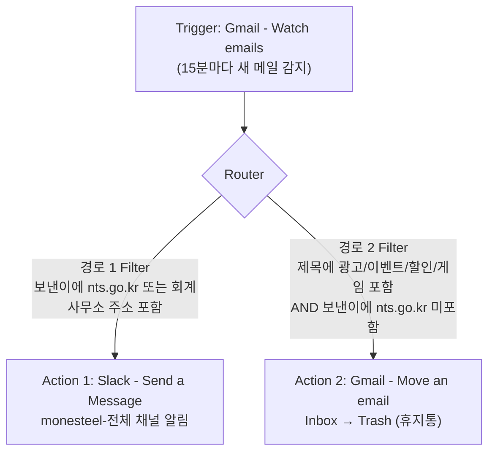

# [프로젝트 2] 자유 주제 자동화 설계 및 구현

## 1. 자동화할 반복 업무 정의

### 업무명
Gmail 수신 메일 자동 분류 및 알림 시스템

### 문제 상황
Monesteel 비즈니스 Gmail 계정으로 매일 다양한 메일이 수신됨:
- 국세청(@nts.go.kr)에서 오는 세무 관련 중요 메일
- 회계사무소 박정아 대리(jung***@nate.com)의 업무 메일
- 대량의 광고/프로모션 메일 (받은편지함 약 10,000통 누적)

### 기존 문제점
| 문제 | 내용 |
|------|------|
| 중요 메일 누락 | 광고 메일에 묻혀 중요 메일을 놓치는 경우 발생 |
| 수동 확인 부담 | 매일 수동으로 메일함을 확인해야 함 |
| 메일함 혼잡 | 광고 메일로 인해 메일함이 지저분해짐 |

### 자동화 목표
- 중요 메일(국세청, 회계사무소) 수신 시 Slack으로 알림
- 광고성 메일 자동 삭제(휴지통 이동)로 메일함 정리

---

## 2. 자동화 도구 선정 및 선정 이유

### 선정 도구: Make (구 Integromat)

### 선정 이유
| 항목 | 내용 |
|------|------|
| 노코드 | 코딩 없이 모듈을 연결해 자동화 구현 가능 |
| Router 지원 | 하나의 트리거에서 여러 경로로 분기하는 **Router**와 경로별 **Filter**를 기본 제공 |
| 시각적 구조 | 캔버스에서 분기 흐름이 한눈에 보여 설계 확인이 쉬움 |
| Gmail 연동 | Watch emails, Move an email 등 Gmail 전용 모듈 제공 |
| Slack 연동 | Send a Message 모듈로 채널 알림 전송 |
| 실행 로그 | History와 Operation별 입출력 데이터로 **어느 경로가 실행되었는지** 확인 가능 |
| 무료 플랜 | 기본 자동화를 무료로 사용 가능 (활성 시나리오 2개 제한 → 한 시나리오에 모두 구현) |

---

## 3. 워크플로우 설계 문서

### 3-1. 구현 요건 충족 현황

| 요건 | 이 워크플로우에서의 구성 |
|------|--------------------------|
| Trigger 1개 이상 | Gmail - Watch emails (새 메일 감지) 1개 |
| Action 2개 이상 | ① Slack - Send a Message ② Gmail - Move an email (휴지통 이동) |
| 조건 분기 1개 이상 | **Router** 1개 + 경로별 Filter 2개 (경로 1: 중요 메일, 경로 2: 광고 메일) |
| 각 분기 경로 1회 이상 실행 | 경로 1(국세청/회계사무소 메일)과 경로 2(광고 메일)를 각각 실행해 결과 확인 (7장) |

### 3-2. 전체 구조 (다이어그램)

하나의 시나리오 안에서 하나의 트리거로 메일을 받고, Router가 조건에 따라 두 경로로 나눈다.



텍스트로 표현하면 다음과 같다.

```
[Trigger] Gmail - Watch emails
        │
     [Router]
        ├─ 경로 1: 보낸이 = 국세청 / 회계사무소 ──▶ [Action 1] Slack 알림 전송
        │
        └─ 경로 2: 제목에 광고성 키워드 ──────────▶ [Action 2] Gmail 휴지통 이동
```

### 3-3. 모듈별 설정

| 순서 | 모듈 | 설정 내용 |
|------|------|-----------|
| 1 | **Gmail - Watch emails** (Trigger) | Filter type: Gmail filter / Query: `in:inbox -from:me (from:{nts.go.kr jung***@nate.com} OR subject:(광고 OR 이벤트 OR 할인 OR 게임 OR "(AD)" OR "[AD]"))` / Mark as read: No / Limit: 10 / Choose where to start: From now on |
| 2 | **Router** | 경로 2개 |
| 3-1 | 경로 1 Filter (Router → Slack 연결선) | 이름: `중요 메일` / 조건: `{{1.from.address}}` Contains `nts.go.kr` **OR** `{{1.from.address}}` Contains `jung***@nate.com` |
| 4-1 | **Slack - Send a Message** (Action 1) | 채널: monesteel-전체 / Text: `📩 중요 메일 도착` + 제목 `{{1.subject}}` + 보낸이 `{{1.from.address}}` |
| 3-2 | 경로 2 Filter (Router → Gmail 연결선) | 이름: `광고 메일` / 조건: `{{1.subject}}` Contains `광고` **OR** `이벤트` **OR** `할인` **OR** `게임` **OR** `(AD)` **OR** `[AD]` **AND** `{{1.from.address}}` Does not contain `nts.go.kr` |
| 4-2 | **Gmail - Move an email** (Action 2) | Source folder: Inbox / Message ID: `1. Message ID` / New folder: Trash |

- Trigger의 Query로 대상 메일을 1차로 좁혀 operations 소모를 줄이고, **Router와 Filter가 실제 분기를 담당**한다.
- 경로 2 Filter에 "보낸이가 국세청이 아님" 조건을 넣어, 제목에 광고성 단어가 있어도 중요 메일은 휴지통으로 가지 않게 보호한다.
- 삭제는 영구 삭제가 아니라 **휴지통 이동**이므로 오분류 시 30일 안에 복구할 수 있다.
- 하나의 시나리오로 구성해 Make 무료 플랜의 활성 시나리오 2개 제한 안에서 운영한다.

### 3-4. 워크플로우 흐름 설명

1. Make가 15분 간격으로 시나리오를 실행하면 **Watch emails(Trigger)** 가 Query에 맞는 새 메일을 가져온다.
2. 가져온 메일은 한 통씩 **Router**로 전달된다.
3. **경로 1**: 보낸이가 국세청 또는 회계사무소이면 Filter를 통과해 **Slack 알림(Action 1)** 이 전송된다.
4. **경로 2**: 제목에 광고성 키워드가 있고 국세청 메일이 아니면 Filter를 통과해 **휴지통 이동(Action 2)** 이 실행된다.
5. 어느 조건에도 맞지 않는 메일은 아무 동작 없이 종료된다.
6. 새 메일이 없으면 "The module didn't return any new data"로 종료되며, 이는 정상 동작이다.

### 3-5. 노코드 핵심 개념 적용

| 개념 | 적용 내용 |
|------|-----------|
| 트리거(Trigger) | Gmail Watch emails |
| 조건 분기(Router) | 중요 메일 / 광고 메일 두 경로로 분기 |
| 필터(Filter) | 경로별 발신자·제목 조건 |
| 액션(Action) | Slack 메시지 전송, Gmail 휴지통 이동 |
| 데이터 매핑 | Subject, From, Message ID를 다음 모듈에 연결 |
| 통합(Integration) | Gmail ↔ Make ↔ Slack |
| 스케줄링 | 15분 간격 자동 실행 |

---

## 4. 구현 과정 및 문제 해결

| 문제 | 원인 | 해결 |
|------|------|------|
| Slack 모듈에 "Create a Message"가 없음 | 모듈 이름 변경 | **Send a Message** 사용 |
| "The module didn't return any new data" | 시작 지점이 From now on이라 새 메일이 없음 | Choose where to start로 과거 메일을 선택해 테스트 |
| 메일 1건 테스트인데 Slack에 10건 전송 | 시작 지점은 "그 메일 이후 전체"를 뜻하고 Limit이 10 | 테스트 시 Limit을 1로 낮추고, 테스트 후 From now on과 Limit 10으로 복구 |
| 시나리오 3개째 활성화 불가 | 무료 플랜은 활성 시나리오 2개 제한 | 모든 기능을 **하나의 시나리오(Router 구조)** 로 통합 |
| Update email labels에서 `[400] Invalid label: TRASH` 오류 | 해당 모듈은 휴지통(TRASH)을 라벨로 처리하지 못함 | **Move an email** 모듈(New folder: Trash)로 교체 |
| Labels to add에 Select All이 체크됨 | 선택 실수 | 전체 해제 후 필요한 항목만 선택 |

---

## 5. 구현 화면 캡처

> 📸 **캡처 위치 안내**
> Make → 좌측 **Scenarios** → 해당 시나리오 편집 화면
> - **Router로 두 경로가 갈라지는 전체 워크플로우 화면** (Trigger → Router → Slack / Gmail 이동)
> - Gmail Watch emails 설정 화면 (Filter type, Query, Limit)
> - 경로 1 Filter 설정 화면 (연결선의 필터 아이콘 클릭)
> - 경로 2 Filter 설정 화면
> - Slack Send a Message 설정 화면
> - Gmail Move an email 설정 화면 (Source folder, Message ID, New folder)
> - Scenarios 목록(활성 상태, 실행 주기)
>
> ⚠️ 캡처 전 **6장 보안 체크리스트**로 민감정보를 가린다.

### 전체 워크플로우 화면 (Router 분기)


### 모듈 및 Filter 설정 화면


---

## 6. 보안 및 제출물 제약 사항

제출물(스크린샷, 문서, 공유 링크)에 API Key, 토큰, 비밀번호 등 민감정보가 노출되지 않도록 아래 원칙을 적용했다.

### 6-1. 적용 원칙

| 항목 | 처리 방법 |
|------|-----------|
| API Key / 토큰 / 비밀번호 | 문서와 캡처에 포함하지 않음. 보이는 값은 `***`로 마스킹 |
| 계정 이메일 | 일부만 표시하고 나머지는 가림 (예: `jung***@nate.com`) |
| 연결(Connection) 정보 | Gmail/Slack 연결 이름에 포함된 계정명·이메일을 캡처 시 가림 |
| 개인정보가 포함된 메일 | 받은편지함·휴지통 캡처에서 발신자, 제목, 미리보기 중 개인·거래 정보는 단색 박스로 가림 |
| 워크스페이스/채널 정보 | 필요한 범위만 노출 |
| 공유 링크 | 민감정보가 없는지 확인 후 제출 |

### 6-2. 캡처 전 점검 체크리스트

- [ ] Connection 선택 칸에 이메일 주소/계정명이 노출되지 않았는가
- [ ] Slack 연결의 Token, Webhook URL, Client Secret 등이 보이지 않는가
- [ ] Filter 조건과 Query에 적은 회계사무소 이메일 주소가 마스킹되었는가
- [ ] 브라우저 주소창·탭 제목에 계정 정보나 다른 업무 페이지가 노출되지 않았는가
- [ ] Gmail 화면의 발신자/제목/첨부파일명에 거래처·신용정보·견적 내용이 보이지 않는가
- [ ] Slack 알림 캡처의 보낸이 주소와 제목이 마스킹되었는가
- [ ] 마스킹이 흐림이 아닌 단색 박스로 완전히 가려졌는가

### 6-3. 이번 구현에서의 민감정보 취급

- Gmail과 Slack은 **OAuth 계정 연결**로 연동했으며, 비밀번호나 API Key를 직접 입력하거나 문서에 기록하지 않았다.
- 모듈 설정에는 매핑 값(`1. Message ID`, `{{1.subject}}`, `{{1.from.address}}` 등)만 사용했다.
- 제출 후 필요하면 Make Connections에서 Gmail/Slack 연결을 해제한다.

---

## 7. 실행 결과 화면 캡처 (분기 경로별 실행 확인)

조건 분기(Router)가 있으므로 **각 경로가 실제로 1회 이상 실행된 결과**를 따로 확인한다.

### 7-1. 테스트 방법

| 항목 | 방법 |
|------|------|
| 경로 1 실행 | Watch emails → **Choose where to start** → Choose manually에서 국세청 또는 회계사무소 메일 1건 선택, **Limit 1** → **Run once** |
| 경로 2 실행 | 같은 방식으로 받은편지함의 광고성 메일(제목에 광고/이벤트/할인 포함) 1건 선택, **Limit 1** → **Run once** |
| 확인 | 실행 후 각 모듈 위 말풍선 숫자(실행된 경로에만 숫자 표시), History의 Operation 기록, Slack 채널, Gmail 휴지통 |
| 복구 | 테스트 후 시작 지점을 **From now on**, Limit을 **10**으로 복구하고 Save |

### 7-2. 경로 1 실행 결과 - 중요 메일 → Slack 알림
> 📸 Run once 직후 **Router 이후 Slack 모듈에만 말풍선 숫자(1)가 표시**된 시나리오 화면 + History + Slack 채널의 알림 메시지


### 7-3. 경로 2 실행 결과 - 광고 메일 → 휴지통 이동
> 📸 Run once 직후 **Move an email 모듈에만 말풍선 숫자(1)가 표시**된 시나리오 화면 + History + Gmail 휴지통에 들어간 해당 메일


### 7-4. 분기 실행 확인표 (제출 전 작성)

| 분기 경로 | 입력한 테스트 메일 | 실행된 Action | 결과 확인 | 상태 |
|-----------|--------------------|---------------|-----------|------|
| 경로 1 | 국세청/회계사무소 메일 1건 | Slack Send a Message | Slack 채널 수신 | ☐ 확인 |
| 경로 2 | 광고성 제목 메일 1건 | Gmail Move an email | 휴지통 이동 | ☐ 확인 |

---

## 8. 구현 결과 요약

| 구성 | 내용 | 상태 |
|------|------|------|
| Trigger | Gmail Watch emails | 구현 |
| Router + Filter | 중요 메일 / 광고 메일 분기 | 구현 (경로별 실행 확인 필요) |
| Action 1 | Slack Send a Message | 구현 |
| Action 2 | Gmail Move an email (휴지통) | 구현 (실행 확인 필요) |

### 기대 효과
- ✅ 중요 메일을 Slack으로 확인해 업무 누락 방지
- ✅ 광고 메일 자동 정리로 메일함 효율화
- ✅ 수동 메일 확인 시간 절약
- ✅ 코딩 없이 노코드로 조건 분기 자동화 구현

### 한계 및 개선 방향
- 무료 플랜은 실행 주기가 15분이라 알림이 최대 15분 늦을 수 있다.
- 제목 키워드 기반 필터는 일반 메일을 오분류할 수 있어, 휴지통 이동 방식과 발신자 예외 조건으로 보완한다.
- 어느 경로에도 해당하지 않는 메일은 처리하지 않으며, 필요하면 Fallback 경로(라벨 지정 등)를 추가할 수 있다.

---

*작성자: 성규 장*
*작성일: 2026년 10월*
*사용 도구: Make (노코드 자동화 플랫폼)*
