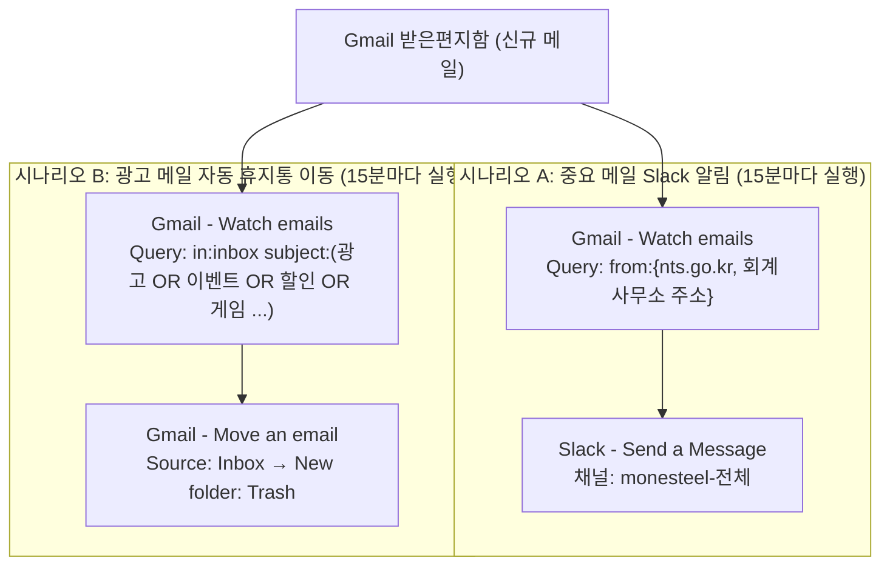

# [프로젝트 2] 자유 주제 자동화 설계 및 구현

## 1. 자동화할 반복 업무 정의

### 업무명
Gmail 수신 메일 자동 분류 및 알림 시스템

### 문제 상황
Monesteel 비즈니스 Gmail 계정으로 매일 다양한 메일이 수신됨:
- 국세청(@nts.go.kr)에서 오는 세무 관련 중요 메일
- 회계사무소 박정아 대리(jung***@nate.com)의 업무 메일
- 대량의 광고/프로모션 메일 (받은편지함 약 10,000통 누적)

### 기존 문제점
| 문제 | 내용 |
|------|------|
| 중요 메일 누락 | 광고 메일에 묻혀 중요 메일을 놓치는 경우 발생 |
| 수동 확인 부담 | 매일 수동으로 메일함을 확인해야 함 |
| 메일함 혼잡 | 광고 메일로 인해 메일함이 지저분해짐 |

### 자동화 목표
- 중요 메일(국세청, 회계사무소) 수신 시 Slack으로 알림
- 광고성 메일 자동 삭제(휴지통 이동)로 메일함 정리

---

## 2. 자동화 도구 선정 및 선정 이유

### 선정 도구: Make (구 Integromat)

### 선정 이유
| 항목 | 내용 |
|------|------|
| 노코드 | 코딩 없이 모듈을 연결해 자동화 구현 가능 |
| 시각적 구조 | 캔버스에서 모듈 연결 흐름이 한눈에 보여 설계 확인이 쉬움 |
| Gmail 연동 | Watch emails, Move an email 등 Gmail 전용 모듈 제공 |
| 세밀한 조건 설정 | Gmail 검색 문법(Query: `from:`, `subject:`, `OR`, `in:inbox`)을 그대로 사용 가능 |
| Slack 연동 | Send a Message 모듈로 채널 알림 전송 |
| 실행 로그 | History와 Operation별 입출력 데이터를 상세히 확인 가능 |
| 무료 플랜 | 기본 자동화를 무료로 사용 가능 (활성 시나리오 2개 제한) |

---

## 3. 워크플로우 설계 문서

### 3-1. 전체 구조 (다이어그램)



텍스트로 표현하면 다음과 같다.

```
[Gmail 받은편지함: 신규 메일]
        │
        ├─ 발신자가 국세청 / 회계사무소 ──▶ [시나리오 A] Slack monesteel-전체 채널로 알림
        │
        └─ 제목에 광고/이벤트/할인/게임 등 ─▶ [시나리오 B] Gmail 휴지통으로 이동
```

### 3-2. 시나리오 A - 국세청/회계사무소 메일 → Slack 알림

| 순서 | 모듈 | 설정 내용 |
|------|------|-----------|
| 1 | Gmail - Watch emails (트리거) | Filter type: Gmail filter / Query: `from:{nts.go.kr jung***@nate.com}` / Folder: Inbox / Mark as read: No / Limit: 10 / Choose where to start: From now on |
| 2 | Slack - Send a Message (액션) | 채널: monesteel-전체 / Text: `📩 새 메일 도착` + 제목 `{{1.subject}}` + 보낸이 `{{1.from.address}}` |

- 국세청과 회계사무소를 하나의 시나리오에서 처리한다. Make 무료 플랜은 동시에 활성화할 수 있는 시나리오가 2개로 제한되기 때문이다. 보낸이 주소로 어느 쪽 메일인지 구분한다.

### 3-3. 시나리오 B - 광고 메일 → 휴지통 이동

| 순서 | 모듈 | 설정 내용 |
|------|------|-----------|
| 1 | Gmail - Watch emails (트리거) | Filter type: Gmail filter / Query: `in:inbox subject:(광고 OR 이벤트 OR 할인 OR 게임 OR "(AD)" OR "[AD]") -from:me` / Mark as read: No / Limit: 10 / Choose where to start: From now on |
| 2 | Gmail - Move an email (액션) | Source folder: Inbox / Message ID: `1. Message ID` (트리거에서 동적 연결) / New folder: Trash |

- 삭제는 영구 삭제가 아닌 **휴지통 이동**으로 처리해, 오분류 시 30일 안에 복구할 수 있게 했다.
- 국세청·회계사무소 메일이 오분류되지 않도록 필요하면 Query에 `-from:{nts.go.kr 회계사무소주소}`를 추가한다.

### 3-4. 워크플로우 흐름 설명

1. Make가 15분 간격으로 시나리오를 실행하면 Gmail Watch emails 모듈이 Query 조건에 맞는 **새 메일**을 가져온다. (최초 설정 시 시작 지점을 *From now on*으로 두어 과거 메일이 처리되지 않게 했다.)
2. 시나리오 A는 가져온 메일마다 Slack 모듈이 한 번씩 실행되어 제목과 보낸이를 채널에 전송한다.
3. 시나리오 B는 가져온 메일마다 Move an email 모듈이 Message ID로 해당 메일을 찾아 휴지통으로 옮긴다.
4. 조건에 맞는 메일이 없으면 "The module didn't return any new data"로 종료되며, 이는 오류가 아닌 정상 동작이다.

### 3-5. 노코드 핵심 개념 적용

| 개념 | 적용 내용 |
|------|-----------|
| 트리거(Trigger) | Gmail Watch emails (새 메일 감지) |
| 필터(Filter) | Gmail Query로 발신자/제목 조건 지정 |
| 액션(Action) | Slack 메시지 전송 / Gmail 휴지통 이동 |
| 데이터 매핑 | 트리거의 Subject, From, Message ID를 다음 모듈에 연결 |
| 통합(Integration) | Gmail ↔ Make ↔ Slack |
| 스케줄링 | 15분 간격 자동 실행 |

---

## 4. 구현 과정 및 문제 해결

| 문제 | 원인 | 해결 |
|------|------|------|
| Slack 모듈에 "Create a Message"가 없음 | 모듈 이름 변경 | **Send a Message** 사용 |
| "The module didn't return any new data" | 시작 지점이 From now on이라 새 메일이 없음 | Choose where to start로 과거 메일을 선택해 테스트 |
| 메일 1건 테스트인데 Slack에 10건 전송 | 시작 지점은 "그 메일 이후 전체"를 뜻하고 Limit이 10 | 테스트 시 Limit을 1로 낮추고, 테스트 후 From now on과 Limit 10으로 복구 |
| 시나리오 3개째 활성화 불가 | 무료 플랜은 활성 시나리오 2개 제한 | 국세청/회계사무소 알림을 한 시나리오로 통합 |
| Update email labels에서 `[400] Invalid label: TRASH` 오류 | 해당 모듈은 휴지통(TRASH)을 라벨로 처리하지 못함 | **Move an email** 모듈(New folder: Trash)로 교체 |
| Labels to add에 Select All이 체크됨 | 선택 실수 | 전체 해제 후 필요한 항목만 선택 |

---

## 5. 구현 화면 캡처

> 📸 **캡처 위치 안내**
> Make → 좌측 **Scenarios** → 각 시나리오 클릭 → 편집 화면
> - 시나리오 A, B 전체 워크플로우(모듈 연결) 화면
> - Gmail Watch emails 설정 화면 (Filter type, Query, Limit)
> - Slack Send a Message 설정 화면
> - Gmail Move an email 설정 화면 (Source folder, Message ID, New folder)
> - Scenarios 목록(활성 상태, 실행 주기 확인)
>
> ⚠️ 캡처 전 **6장 보안 체크리스트**로 민감정보를 가린다.

### 시나리오 A 구현 화면


### 시나리오 B 구현 화면


### 모듈 설정 화면


---

## 6. 보안 및 제출물 제약 사항

제출물(스크린샷, 문서, 공유 링크)에 API Key, 토큰, 비밀번호 등 민감정보가 노출되지 않도록 아래 원칙을 적용했다.

### 6-1. 적용 원칙

| 항목 | 처리 방법 |
|------|-----------|
| API Key / 토큰 / 비밀번호 | 문서와 캡처에 포함하지 않음. 보이는 값은 `***`로 마스킹 |
| 계정 이메일 | 일부만 표시하고 나머지는 가림 (예: `jung***@nate.com`) |
| 연결(Connection) 정보 | Gmail/Slack 연결 이름에 포함된 계정명·이메일을 캡처 시 가림 |
| 개인정보가 포함된 메일 | 받은편지함·휴지통 캡처에서 발신자, 제목, 미리보기 중 개인·거래 정보는 단색 박스로 가림 |
| 워크스페이스/채널 정보 | 필요한 범위만 노출 |
| 공유 링크 | 민감정보가 없는지 확인 후 제출 |

### 6-2. 캡처 전 점검 체크리스트

- [ ] Connection 선택 칸에 이메일 주소/계정명이 노출되지 않았는가
- [ ] Slack 연결의 Token, Webhook URL, Client Secret 등이 보이지 않는가
- [ ] 브라우저 주소창·탭 제목에 계정 정보나 다른 업무 페이지가 노출되지 않았는가
- [ ] Gmail 화면의 발신자/제목/첨부파일명에 거래처·신용정보·견적 내용이 보이지 않는가
- [ ] 마스킹이 흐림이 아닌 단색 박스로 완전히 가려졌는가
- [ ] 문서 안의 실제 이메일 주소가 마스킹되었는가

### 6-3. 이번 구현에서의 민감정보 취급

- Gmail과 Slack은 **OAuth 계정 연결**로 연동했으며, 비밀번호나 API Key를 직접 입력하거나 문서에 기록하지 않았다.
- 모듈 설정에는 매핑 값(`1. Message ID`, `{{1.subject}}` 등)만 사용했다.
- 제출 후 필요하면 Make Connections에서 Gmail/Slack 연결을 해제한다.

---

## 7. 실행 결과 화면 캡처

> 📸 **캡처 위치 안내**
>
> **① Make 실행 결과**
> - 시나리오 편집 화면 → **Run once** 실행 → 모듈 위 말풍선 숫자와 초록 체크(✅) 확인
> - 시나리오 **History** 탭의 실행 기록 (Operation 성공 여부)
>
> **② Slack 알림 수신 결과 (시나리오 A)**
> - Slack → monesteel 워크스페이스 → **전체** 채널의 자동 알림 메시지
>
> **③ Gmail 휴지통 이동 결과 (시나리오 B)**
> - Gmail → **휴지통** 폴더에서 자동 이동된 광고 메일
>
> ⚠️ 발신자·제목 중 개인/거래 정보는 반드시 가린다.

### 시나리오 A 실행 결과 - Slack 알림


### 시나리오 B 실행 결과 - 광고 메일 휴지통 이동


---

## 8. 구현 결과 요약

| 시나리오 | 기능 | 상태 |
|----------|------|------|
| A | 국세청/회계사무소 메일 → Slack 알림 | 🟢 구현 및 테스트 완료 (Active) |
| B | 광고 메일 → 휴지통 이동 | 🟡 Move an email 적용 후 최종 동작 확인 필요 |

### 기대 효과
- ✅ 중요 메일을 Slack으로 확인해 업무 누락 방지
- ✅ 광고 메일 자동 정리로 메일함 효율화
- ✅ 수동 메일 확인 시간 절약
- ✅ 코딩 없이 노코드로 자동화 구현

### 한계 및 개선 방향
- 무료 플랜은 실행 주기가 15분이라 알림이 최대 15분 늦을 수 있다.
- 제목 키워드 기반 필터는 일반 메일(예: "할인 적용 안내")을 오분류할 수 있어, 휴지통 이동 방식과 `-from:` 예외 조건으로 보완한다.

---

*작성자: 성규 장*
*작성일: 2026년 10월*
*사용 도구: Make (노코드 자동화 플랫폼)*
